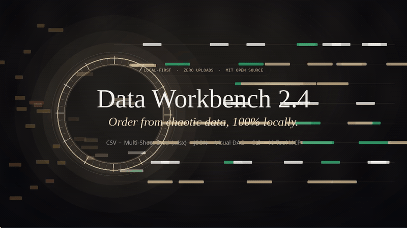

# Data Workbench 2.3

> **Local-first Visual Data Transformation & Automation Studio** — Turn messy files into reliable, repeatable, testable data workflows.

[](./LICENSE)
[](https://nodejs.org)
[](#architecture)

**Data Workbench 2.0** unifies browser-local visual data cleaning, explainable data quality auditing, primary-key diffing, Schema Guardian drift checks, and deterministic workflow automation across **Web Studio**, **CLI (`dw`)**, **GitHub Actions**, and **MCP Server** — all powered by a single zero-dependency engine.

---



## v2.3 Highlights
- **Native Zero-Dependency `.xlsx` (Excel) Support:** Read & write Excel workbooks locally in Browser and CLI (`source.xlsx`, `output.xlsx`) + Parquet header inspection & DuckDB-Wasm handoff (`source.parquet`).
- **OpenRefine-Style Fuzzy Clustering:** `clean.clusterMerge` (Key-Collision Fingerprint + Levenshtein).
- **`npx` Ready & Launch Kit:** Run via `npx data-workbench` or `npx data-workbench-mcp --sandbox ./data`. See [docs/LAUNCH_PLAYBOOK.md](./docs/LAUNCH_PLAYBOOK.md).

## v2.1 Engine Architecture

- **ColumnarTable + Copy-on-Write (`packages/engine-core`):** Numeric `Float64Array` + null validity bitmaps + `DictionaryColumn` encoding (`Uint32Array`), sharing untouched columns zero-copy across nodes.
- **Pluggable Execution Adapters:** Built-in Tier-1 `ColumnarJsAdapter` (zero cold-start) + standard `DuckDbWasmAdapter` contract + `OpfsStorageAdapter`.
- **True Incremental CSV Stream State Machine:** `CsvStreamParser` handles arbitrary byte/chunk boundaries across quotes, CRLF, and multibyte UTF-8.
- **Named Multi-Port DAG & Dynamic Plugin SDK:** Supports `out` / `errors` split ports, `left`/`right` join/diff ports, `registerNode()`, JSON Schema `paramSchema` validation, and `migrate(params, fromVersion)` hooks.
- **Dedicated Web Worker Execution:** Runs DAG workflows off the browser main thread with instant Cancel and live memory telemetry.

## Core Capabilities

- **100% Local-First Privacy:** Files are parsed, profiled, diffed, and transformed locally in your browser or terminal. Zero uploads, zero telemetry of cell values.
- **3 Synchronized Modes (Single Source of Truth):**
  - **Table Mode:** Virtualized Data Grid with **Data Quality Radar** (Completeness, Uniqueness, Validity, Consistency), clickable issue filters, **Fix Preview + Confidence**, **PII Sentinel**, and **Explain This Dataset**.
  - **Canvas Mode:** Interactive DAG node editor with drag-to-arrange nodes, Bezier connections, auto-layout, zoom, node status indicators, and **Before/After Data Diff** per step.
  - **Code Mode:** Live read-only **SQL Preview**, **Workflow JSON v1.0**, and **CLI command** generated from the same workflow definition.
- **28 Deterministic Versioned Nodes:** CSV, JSON, NDJSON, YAML, XML sources/outputs, CSV dialect repair, text/date normalization, PII masking (`mask`/`hash`/`remove`/`synthetic`/`keepLast`), deduplication, filtering, sorting, flatten/unflatten, RFC 9535 JSONPath, local SQL-lite query, Data Contracts, JSON Schema 2020-12, and primary-key/JSON diffs.
- **Data Trust Built In:** **Schema Guardian** (snapshot & breaking-change drift detection), **Data Contracts**, **Workflow Regression Tests**, **CSV Formula Injection Protection**, and **Portable Workflow Packages**.
- **Local Deterministic AI Rule Copilot:** Translates English or Chinese instructions into a reviewable, approval-gated operation plan with zero external data transfer.
- **10 Standalone SEO Tool Views:** CSV Cleaner, JSON Formatter, JSON Validator, JSON Diff, CSV↔JSON, CSV Deduplicator, Compare Two CSV Files, JSON Schema Generator, and RFC 9535 JSONPath Tester.

---

## Quick Start

No `npm install` is required — the entire monorepo runs natively on **Node.js ≥ 18** with zero third-party dependencies.

```bash
git clone https://github.com/waterdolphinkiller/data-workbench.git
cd data-workbench

# Run the full automated test suite
npm test

# Run performance benchmarks (10k & 100k rows)
npm run bench

# Build the standalone offline Web Studio (apps/web/dist/index.html)
npm run build:web
```

Open `apps/web/dist/index.html` directly in any modern browser (or deploy `apps/web/dist/` to GitHub Pages).

---

## CLI Usage (`dw`)

```bash
# Run a repeatable workflow on a new CSV file
node apps/cli/bin/dw.js run examples/01-messy-customers-cleanup/workflow.json \
  --input examples/01-messy-customers-cleanup/sample-input.csv \
  --output ./out/clean-customers.json \
  --report ./out/run-report.json

# Validate an input dataset against a Data Contract (exits 1 on failure)
node apps/cli/bin/dw.js validate examples/01-messy-customers-cleanup/sample-input.csv \
  --contract examples/01-messy-customers-cleanup/contract.json

# Run Workflow Regression Tests
node apps/cli/bin/dw.js test examples/01-messy-customers-cleanup/workflow.json \
  --input examples/01-messy-customers-cleanup/sample-input.csv \
  --expectations examples/01-messy-customers-cleanup/expectations.json

# Primary-key CSV diff (Markdown, JSON, or XSS-safe HTML)
node apps/cli/bin/dw.js diff old.csv new.csv --key sku --format html --output diff.html
```

---

## MCP Server (Sandboxed AI Agent Integration)

Start the JSON-RPC 2.0 stdio MCP server confined to an explicit directory sandbox:

```bash
node apps/mcp-server/src/server.js --sandbox ./examples
```

Available 10 AI-Native tools: `list_nodes`, `validate_workflow`, `compile_plan`, `inspect_file`, `profile_dataset`, `validate_schema`, `preview_transform`, `run_workflow` (inline workflow + `dryRun`), `compare_files`, and `get_run_report` — all with fuzzy alias resolution, structured self-healing `didYouMean` error hints, token-budget `compact` mode, and automatic PII redaction.

### Local OpenAPI 3.1 REST Server
```bash
npm run api   # binds strictly to http://127.0.0.1:4173 (OpenAPI spec at /openapi.json)
```

---

## Repository Structure

```text
data-workbench/
├── apps/
│   ├── web/                # Local-first Visual Workbench Studio + 10 SEO Tool Views
│   ├── cli/                # `dw` deterministic CLI runner
│   └── mcp-server/         # Sandboxed JSON-RPC 2.0 MCP Server
├── packages/
│   ├── csv-engine/         # Dialect/encoding detector, streaming parser, formula guard
│   ├── json-engine/        # Validator, formatter, NDJSON, Flatten, RFC 9535 JSONPath, YAML/XML
│   ├── quality-engine/     # Data Quality Radar, PII Sentinel, Fix Preview, Explain Dataset
│   ├── diff-engine/        # CSV primary-key/row-hash diff, JSON diff, safe report exporters
│   ├── workflow-schema/    # Workflow JSON v1.0 DAG validator, JSON Schema 2020-12, Drift, Contracts
│   ├── node-registry/      # 28 deterministic versioned workflow nodes
│   ├── workflow-core/      # DAG Executor, Recorder (Undo/Redo), Regression Tests, Copilot, Packages
│   └── test-fixtures/      # 3 onboarding datasets & benchmark generator
├── examples/               # 5 runnable workflow packages
├── scripts/                # Zero-dependency standalone HTML bundler
├── tests/                  # Automated unit/integration/CLI/MCP tests & benchmarks
└── .github/                # CI workflow & reusable Data Workbench GitHub Action
```

---

## Contributing & Governance

- [CONTRIBUTING.md](./CONTRIBUTING.md)
- [SECURITY.md](./SECURITY.md)
- [PRIVACY.md](./PRIVACY.md)
- [CODE_OF_CONDUCT.md](./CODE_OF_CONDUCT.md)
- [LICENSE](./LICENSE) (MIT)
